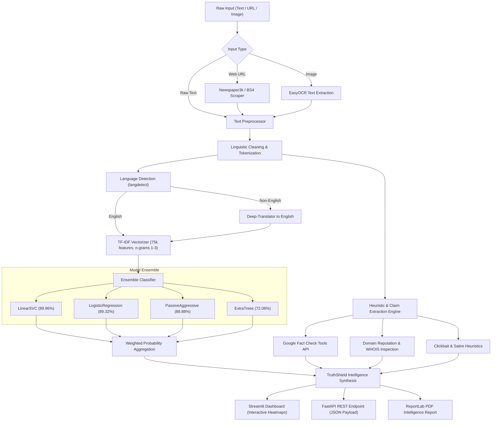

# TruthShield — AI Credibility Intelligence Platform

<p align="center">
  
  
  
  
  
  
  
  
  
</p>

---

## Executive Overview

**TruthShield** is a full-stack, explainable Artificial Intelligence platform designed to analyze the credibility of digital news articles and public claims. Rather than providing an opaque binary classification, TruthShield executes a multi-stage credibility assessment combining:

1. **Multi-Model Machine Learning Ensemble:** Combining linear SVM, logistic regression, passive-aggressive classification, and extra-trees over large-scale TF-IDF linguistic feature vectors.
2. **Explainable AI (XAI):** Sentence-level suspicion heatmaps and SHAP feature attribution to highlight the linguistic patterns driving each prediction.
3. **External Evidence & Fact Verification:** Integration with the Google Fact Check Tools API, domain reputation databases (MBFC), and WHOIS domain age inspection.
4. **Multilingual & Multimodal Support:** Indian language processing (Hindi, Bengali, Tamil, Telugu, etc.) via deep translation and image text extraction with EasyOCR.

> [!NOTE]
> **Probabilistic Classification vs. Factual Verification:** TruthShield distinguishes between *linguistic credibility probability* (derived from stylometric and linguistic patterns) and *authoritative factual verification* (retrieved from verified external fact-checking bodies). The application highlights evidence, sources, and statistical confidence rather than claiming infallible factual guarantees.

---

## Verified Machine Learning Performance

All performance metrics below are empirically evaluated against an independent, held-out test split of **25,754 articles** from a combined historical corpus of **128,769 articles** (stored in `model/evaluation_metrics.json`):

| Evaluation Metric | Measured Value | Description / Context |
|---|---|---|
| **Total Dataset Size** | **128,769 articles** | Aggregated from verified benchmark fake and real news datasets |
| **Training Partition** | **103,015 articles** | 80% train split used for vectorization and model fitting |
| **Test Partition** | **25,754 articles** | 20% strictly held-out partition for unbiased evaluation |
| **Ensemble Accuracy** | **89.92%** | Overall correct classification rate on held-out test set |
| **Precision (Weighted)** | **89.04%** | Accuracy of positive (real/fake) assertions |
| **Recall (Sensitivity)** | **93.36%** | Ability of the system to correctly identify credible reporting |
| **F1-Score** | **0.9115** | Harmonic mean of precision and recall |
| **ROC-AUC** | **0.9652** | Area under the Receiver Operating Characteristic curve |

### Sub-Model Performance Breakdown

The production ensemble weights predictions across four distinct classifiers trained on **75,000 TF-IDF features** with an n-gram range of `(1, 3)`:

```
  Model Architecture          Individual Test Accuracy
  ────────────────────────────────────────────────────
  LinearSVC                   89.96%
  LogisticRegression          89.32%
  PassiveAggressiveClassifier 88.88%
  ExtraTreesClassifier        72.06%
  ────────────────────────────────────────────────────
  VOTING ENSEMBLE             89.92% (ROC-AUC: 0.9652)
```

### Empirical Confusion Matrix (Test Split: 25,754)

```
                       Predicted FAKE    Predicted REAL
  Actual FAKE (11,437)      9,791 (TN)        1,646 (FP)
  Actual REAL (14,317)        950 (FN)       13,367 (TP)
```

---

## System Architecture & Data Flow

The diagram below details the pipeline executed when an article URL or text passage is submitted for credibility analysis:



---

## Repository Layout

```
Fake-News-Detector/
├── README.md                          # Master project documentation
├── docs/                              # Architectural documentation & guides
│   ├── INTERVIEW_PREP.md              # 15 technical interview questions & answers
│   ├── SETUP_GUIDE.md                 # Detailed local deployment guide
│   └── SYSTEM_SUMMARY.md              # Deep technical component breakdown
└── fake-news-detector/                # Primary application source
    ├── requirements.txt               # Pinned Python package dependencies
    ├── start.py                       # Unified service launcher
    ├── src/                           # Application entrypoints
    │   ├── app.py                     # Streamlit frontend dashboard
    │   └── api_server.py              # Headless FastAPI microservice
    ├── model/                         # Saved artifacts and evaluation
    │   ├── evaluation_metrics.json    # Verified empirical metrics
    │   └── README.md                  # Model weights and artifact guide
    ├── scripts/                       # Training, evaluation & export pipelines
    │   ├── train_model.py             # Main ensemble training script
    │   ├── export_onnx.py             # ONNX Runtime graph export
    │   └── augment_training_data.py   # Dataset expansion & balance
    ├── utils/                         # Core utility & analytical engines
    │   ├── pipeline.py                # End-to-end orchestration pipeline
    │   ├── preprocess.py              # Regex, tokenization & lemmatization
    │   ├── claim_verifier.py          # Google Fact Check API integration
    │   ├── source_engine.py           # Domain reputation & bias database
    │   ├── nlp_engine.py              # Sentiment & lexical complexity scoring
    │   ├── clickbait_detector.py      # Headline sensationalism heuristics
    │   ├── image_verifier.py          # EasyOCR image text pipeline
    │   └── pdf_generator.py           # ReportLab automated PDF generator
    ├── testing/                       # Quality assurance & verification
    │   ├── test_suite.py              # Automated unit tests
    │   └── stress_test_hard.py        # Edge-case linguistic stress tests
    └── browser_extension/             # Chrome extension client
```

---

## Installation & Quick Start

### Prerequisites
* Python 3.10, 3.11, or 3.12
* Git and virtual environment tools (`venv` or `uv`)

### 1. Clone & Set Up Virtual Environment
```bash
git clone https://github.com/AnirbanSarkar225/Fake-News-Detector.git
cd Fake-News-Detector/fake-news-detector

# Create and activate virtual environment
python -m venv .venv
# On Windows:
.venv\Scripts\activate
# On Linux/macOS:
source .venv/bin/activate
```

### 2. Install Dependencies
```bash
pip install --upgrade pip
pip install -r requirements.txt
python -m spacy download en_core_web_sm
```

### 3. Environment Configuration
Create a `.env` file inside `fake-news-detector/` (optional, for external fact-checking APIs):
```env
# Optional: Google Fact Check Tools API Key
GOOGLE_FACT_CHECK_API_KEY=your_google_cloud_api_key_here
```
*(If no API key is provided, the platform operates using the local ensemble and offline heuristic engines without crashing).*

### 4. Run Application
```bash
# Launch interactive Streamlit UI
streamlit run src/app.py

# Alternatively, launch headless FastAPI service
uvicorn src.api_server:app --host 0.0.0.0 --port 8000 --reload
```

---

## Testing & Verification

Run the automated test suite to verify pipeline components, regex filters, and classifier loading:
```bash
cd fake-news-detector
python testing/test_suite.py
python testing/stress_test_hard.py
```

---

## Security & Safe Operational Practices

1. **Input Sanitization:** URL inputs are validated and restricted against SSRF risks; text inputs undergo regex sanitization before vectorization to prevent memory bloat.
2. **Credential Management:** External API keys are read via environment variables using `python-dotenv` and never hardcoded in scripts.
3. **No Automated Fact Claims:** Output reports explicitly denote confidence intervals and external source URLs, avoiding deterministic claims of objective truth.

---

## License & Technical Preparation

* Licensed under the [MIT License](LICENSE).
* For detailed engineering trade-offs, architecture decisions, and interviewer Q&A, refer to the [Technical Interview Guide](docs/INTERVIEW_PREP.md).
